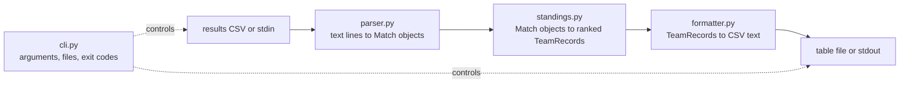

# Football League Standings
 
A command-line application that reads football match results from a CSV file and prints a league table using the rules of the **English First Division in 1974/75**. It is applied here to **matchweek 10 of the 1974/75 season (Saturday 28 September 1974)**.
 
- Python 3.10+, **standard library only** (`pytest` is needed only to run the tests)
- Reads a file or stdin, writes a file or stdout
- Clear error messages with line numbers for bad input
- 28 automated tests, including an end-to-end test against a table worked out independently by hand
## Contents
 
1. [Quick start](#quick-start)
2. [The result: matchweek 10, 1974/75](#the-result-matchweek-10-197475)
3. [Rules used](#rules-used)
4. [Usage](#usage)
5. [Input and output formats](#input-and-output-formats)
6. [How it works](#how-it-works)
7. [Assumptions and interpretation](#assumptions-and-interpretation)
8. [Data sources and verification](#data-sources-and-verification)
9. [Testing](#testing)
10. [Project structure](#project-structure)
11. [How I used AI](#how-i-used-ai)
12. [Limitations and possible extensions](#limitations-and-possible-extensions)
13. [Troubleshooting](#troubleshooting)
## Quick start
 
Requires Python 3.10 or newer on macOS or Linux.
 
```bash
git clone <your-repo-url>
cd football-standing
 
python3 -m venv .venv
source .venv/bin/activate
pip install pytest
 
python -m pytest
python -m league.cli data/input_1974_75_week10.csv
```
 
To save the table to a file instead of printing it:
 
```bash
python -m league.cli data/input_1974_75_week10.csv -o data/output_1974_75_week10.csv
```
 
No other setup is needed. The `.venv` folder is not committed.
 
## The result: matchweek 10, 1974/75
 
The input is the 11 First Division matches played in matchweek 10 (Saturday 28 September 1974). Every one of the 22 clubs played exactly once.
 
| Home | Score | Away |
|---|---|---|
| Birmingham City | 3–1 | Arsenal |
| Burnley | 3–5 | West Ham United |
| Chelsea | 0–1 | Wolverhampton Wanderers |
| Everton | 3–2 | Leeds United |
| Leicester City | 0–1 | Coventry City |
| Luton Town | 3–1 | Carlisle United |
| Manchester City | 1–0 | Queens Park Rangers |
| Newcastle United | 1–0 | Ipswich Town |
| Sheffield United | 1–0 | Liverpool |
| Stoke City | 1–1 | Derby County |
| Tottenham Hotspur | 1–2 | Middlesbrough |
 
The program's output (`data/output_1974_75_week10.csv`), shown as a table:
 
| Pos | Team | P | W | D | L | GF | GA | GAv | Pts |
|---:|---|---:|---:|---:|---:|---:|---:|---:|---:|
| 1 | Coventry City | 1 | 1 | 0 | 0 | 1 | 0 | inf | 2 |
| 2 | Manchester City | 1 | 1 | 0 | 0 | 1 | 0 | inf | 2 |
| 3 | Newcastle United | 1 | 1 | 0 | 0 | 1 | 0 | inf | 2 |
| 4 | Sheffield United | 1 | 1 | 0 | 0 | 1 | 0 | inf | 2 |
| 5 | Wolverhampton Wanderers | 1 | 1 | 0 | 0 | 1 | 0 | inf | 2 |
| 6 | Birmingham City | 1 | 1 | 0 | 0 | 3 | 1 | 3.000 | 2 |
| 7 | Luton Town | 1 | 1 | 0 | 0 | 3 | 1 | 3.000 | 2 |
| 8 | Middlesbrough | 1 | 1 | 0 | 0 | 2 | 1 | 2.000 | 2 |
| 9 | West Ham United | 1 | 1 | 0 | 0 | 5 | 3 | 1.667 | 2 |
| 10 | Everton | 1 | 1 | 0 | 0 | 3 | 2 | 1.500 | 2 |
| 11 | Derby County | 1 | 0 | 1 | 0 | 1 | 1 | 1.000 | 1 |
| 12 | Stoke City | 1 | 0 | 1 | 0 | 1 | 1 | 1.000 | 1 |
| 13 | Leeds United | 1 | 0 | 0 | 1 | 2 | 3 | 0.667 | 0 |
| 14 | Burnley | 1 | 0 | 0 | 1 | 3 | 5 | 0.600 | 0 |
| 15 | Tottenham Hotspur | 1 | 0 | 0 | 1 | 1 | 2 | 0.500 | 0 |
| 16 | Arsenal | 1 | 0 | 0 | 1 | 1 | 3 | 0.333 | 0 |
| 17 | Carlisle United | 1 | 0 | 0 | 1 | 1 | 3 | 0.333 | 0 |
| 18 | Chelsea | 1 | 0 | 0 | 1 | 0 | 1 | 0.000 | 0 |
| 19 | Ipswich Town | 1 | 0 | 0 | 1 | 0 | 1 | 0.000 | 0 |
| 20 | Leicester City | 1 | 0 | 0 | 1 | 0 | 1 | 0.000 | 0 |
| 21 | Liverpool | 1 | 0 | 0 | 1 | 0 | 1 | 0.000 | 0 |
| 22 | Queens Park Rangers | 1 | 0 | 0 | 1 | 0 | 1 | 0.000 | 0 |
 
Things worth noticing in this table, because each one exercises a rule:
 
- **Goal average, not goal difference.** West Ham (5 scored, 3 conceded, average 1.667) rank above Everton (3 and 2, average 1.500). West Ham's goal difference of +2 is also better, so a second case helps: Birmingham and Luton (both 3–1, average 3.000) rank above Middlesbrough (2–1, average 2.000), even though all three have a goal difference of +2. Only goal average separates them.
- **Infinite goal average.** Five clubs won 1–0 and conceded nothing, so dividing by zero is avoided and they rank above every finite average.
- **Final tie-breaks.** Those five clubs are level on points, goal average and goals scored, so team name decides (Coventry, Manchester City, Newcastle, Sheffield United, Wolverhampton). The same applies to Birmingham/Luton, Derby/Stoke, Arsenal/Carlisle and the five clubs on 0.000.
## Rules used
 
| Rule | Value |
|---|---|
| Points for a win | 2 |
| Points for a draw | 1 |
| Points for a defeat | 0 |
 
Teams are ranked, best first, by:
 
1. **Points** (more is better)
2. **Goal average**: goals scored divided by goals conceded (higher is better)
3. **Goals scored** (more is better)
4. **Team name**, A to Z
**Why these rules.** In 1974/75 a win was worth two points; three points for a win came in England in 1981/82. Ties on points were broken by goal average, and the Football League only switched to goal difference from 1976/77. The ranking note on the final 1974/75 First Division table (Wikipedia) lists the criteria as points, then goal average, then goals scored.
 
**Step 4 is my own addition.** The sources give no criterion after goals scored. Sorting by name makes the output identical on every run, which matters for the end-to-end test and for anyone comparing outputs.
 
**Goal average edge cases:**
 
| Situation | Goal average | Reason |
|---|---|---|
| Conceded goals > 0 | goals scored ÷ goals conceded | The standard definition |
| Conceded 0, scored > 0 | infinity (`inf`) | Avoids dividing by zero, and a clean sheet should rank above any finite average |
| Scored 0 and conceded 0 | 0.0 | 0÷0 is undefined. This is my own choice and is documented here |
 
## Usage
 
```text
python -m league.cli [input_file] [-o OUTPUT_FILE]
```
 
| Argument | Meaning |
|---|---|
| `input_file` | Path to the results CSV. If omitted, results are read from standard input |
| `-o OUTPUT_FILE` | Write the table to this file. If omitted, the table is printed to standard output |
 
Examples:
 
```bash
# file in, table printed
python -m league.cli data/input_1974_75_week10.csv
 
# file in, file out
python -m league.cli data/input_1974_75_week10.csv -o data/output_1974_75_week10.csv
 
# stdin in, stdout out
cat data/input_1974_75_week10.csv | python -m league.cli
 
# a single result typed on the spot
echo "Everton,2,Leeds United,1" | python -m league.cli
```
 
**Exit codes** (useful in scripts):
 
| Code | Meaning |
|---|---|
| 0 | Success |
| 1 | The input contains a bad line (the message names the line number and shows the line) |
| 2 | The input file is missing or cannot be read |
 
Error messages go to **stderr** and no Python traceback is shown, so the table in stdout is never mixed with an error.
 
## Input and output formats
 
### Input
 
Plain text CSV, one match per line, **no header row**:
 
```text
home_team,home_goals,away_team,away_goals
```
 
Example line: `Everton,3,Leeds United,2`
 
Leading and trailing spaces around each field are removed. Blank lines are skipped. Any other problem stops the run with an error that includes the line number (counted from 1, with blank lines counted):
 
| Problem | Example line | Result |
|---|---|---|
| Wrong number of fields | `Everton,3,Leeds United` | Error |
| Empty team name | `,3,Leeds United,2` | Error |
| Goals are not whole numbers | `Everton,three,Leeds United,2` | Error |
| Negative goals | `Everton,-1,Leeds United,2` | Error |
| A team playing itself | `Everton,1,Everton,0` | Error |
 
The program stops at the first bad line instead of guessing, so a wrong table is never printed silently.
 
### Output
 
CSV with a header row and one row per team, best first:
 
```text
position,team,played,won,drawn,lost,gf,ga,goal_average,points
1,Coventry City,1,1,0,0,1,0,inf,2
```
 
- `goal_average` is shown to three decimals, like the printed league tables of the time. Ranking uses the exact value, not the rounded one.
- An infinite goal average is written as `inf`.
- The Python `csv` module writes the file, so a team name containing a comma would be quoted correctly.
- Lines end with `\n`.
## How it works
 

 
| Module | Single job |
|---|---|
| `league/models.py` | The data types: `Match` (one result) and `TeamRecord` (one team's totals, with `points` and `goal_average` calculated from them) |
| `league/parser.py` | Turn lines of text into `Match` objects, and reject bad lines with `ParseError` |
| `league/standings.py` | Add up every team's results and sort them into table order |
| `league/formatter.py` | Turn the sorted records into CSV text |
| `league/cli.py` | The command line: read the input, call the other modules, write the output, report errors |
 
### Design decisions
 
- **Each module does one job and does not touch files.** Only `cli.py` reads and writes files. The parser takes lines of text and the formatter returns a string, so each can be tested with plain strings and no temporary files.
- **Ranking is one sort key.** The table is sorted with a single tuple key of points, goal average, goals scored and name. Python compares tuples position by position, so each value only matters when everything before it is tied. The three numbers are negated to sort highest first, and the name is left alone so it sorts A to Z. There is no hand-written comparison loop to get wrong.
- **`Match` is immutable and `TeamRecord` is not.** A result is a fact that should not change once read. A team's record is built up as the matches are read.
- **Every team that appears gets a record**, whether it played at home or away.
- **Fail loudly on bad data.** A parse error names the line, so the fix is quick.
- **Standard library only.** Nothing to install except `pytest` for the tests.
## Assumptions and interpretation
 
The brief asks for the standings "in the 10th week of the 1974/75 season". That sentence can be read several ways, so the choices are stated here.
 
1. **"Week 10" means matchweek 10.** Football numbers its rounds of fixtures as matchweeks. The 1974/75 First Division fixture lists on FBref label **Saturday 28 September 1974** as matchweek 10. Counting calendar weeks from the opening day (17 August) would give a different date, so I use the matchweek numbering that football data actually uses.
2. **The table covers that round only.** I read "the matches in the 10th week" literally: the 11 matches played in matchweek 10, giving a table where every club has played once. This is **not** a running total of the whole season so far.
3. **Matchweek 10 is a full round.** All 22 clubs play exactly once, which the input confirms. Matchweek 9 was only a few midweek games on 24 September, so most clubs jump from matchweek 8 to matchweek 10. That is why a cumulative table at that point shows some clubs on 9 games and others on 10.
4. **A cumulative table is a data change, not a code change.** To get season-to-date standings, put every result up to that date in the input file. The program calculates a table from whatever matches it is given.
5. **Home and away are not distinguished.** The 1974/75 rules treat every result the same way, so the home/away split is only kept to identify the two teams.
## Data sources and verification
 
The input file is `data/input_1974_75_week10.csv`. Full source notes are in `data/SOURCES.md`.
 
**Sources**
 
- englishfootballleaguetables.co.uk: the page for 28 September 1974, which lists that day's First Division results
- Wikipedia, *1974–75 Football League First Division*: the results grid for the whole season and the final table with its ranking rules
- FBref: the matchweek numbering of the 1974/75 First Division fixtures
**How the data was checked**
 
1. All 11 scores were compared one by one with the season results grid on Wikipedia. Every score matched.
2. The 11 matches contain each of the 22 clubs exactly once.
3. The program's output was compared with a table calculated by hand from the same 11 results before the program was run. All 22 positions, points and goal averages agreed.
4. The totals of the output must add up, which catches almost any slip:
| Total | Value | Why it must be true |
|---|---|---|
| Played | 22 | 11 matches with two teams each |
| Won / Lost | 10 / 10 | 10 matches had a winner, and every win is a loss for the opponent |
| Drawn | 2 | 1 drawn match (Stoke 1–1 Derby), counted once for each team |
| Goals for / against | 31 / 31 | Every goal scored is a goal conceded, and the 11 matches had 31 goals |
| Points | 22 | 10 wins × 2 points + 2 points for the draw |
 
## Testing
 
```bash
python -m pytest        # run everything (28 tests)
python -m pytest -v     # list each test
```
 
| Test file | What it covers |
|---|---|
| `tests/test_parser.py` | A valid line, whitespace trimming, blank lines skipped, every error case, and the correct line number when a bad line follows blank lines |
| `tests/test_standings.py` | Points for a win, draw and loss, both teams get a record, goals add up across matches, an empty input, infinite goal average, 0.0 for a 0–0 record, goal average beating goal difference, and the tie-breaks by goals scored and then name |
| `tests/test_formatter.py` | The header row, positions, three-decimal formatting, `inf`, a team name with a comma being quoted, and an empty table |
| `tests/test_cli.py` | File in to file out, stdin to stdout, exit code 1 with a line number for a bad line, exit code 2 for a missing file |
| `tests/test_end_to_end.py` | The real input file through the whole program, compared character for character with `tests/expected_week10.csv` (the hand-worked table), plus the totals above |
 
**Do the tests catch mistakes?** As a check, temporarily changing the win value from 2 points to 3 in `models.py` makes several tests fail, including the end-to-end test.
 
**A note on the expected file.** `tests/expected_week10.csv` was worked out by hand from the match results and is deliberately not generated by the program. If the program and the expected file ever disagree, the cause is investigated before either one is changed.
 
## Project structure
 
```text
football-standing/
├── README.md                    this file
├── AGENTS.md                    project instructions for the AI assistant (Codex)
├── AI_REFLECTION.md             reflection on working with the AI
├── .ai-session/
│   └── NOTES.md                 AI tool, model and dates used
├── ai/
│   ├── codex-sessions/          raw Codex session logs (unedited)
│   │   └── TIMELINE.md          readable timeline built from the logs
│   ├── make_timeline.py         script that builds TIMELINE.md
│   └── planning-chat.md         the planning and research chat
├── data/
│   ├── input_1974_75_week10.csv     the 11 matchweek 10 results
│   ├── output_1974_75_week10.csv    the table the program produced
│   └── SOURCES.md                   where the data came from
├── league/
│   ├── __init__.py
│   ├── models.py
│   ├── parser.py
│   ├── standings.py
│   ├── formatter.py
│   └── cli.py
└── tests/
    ├── test_parser.py
    ├── test_standings.py
    ├── test_formatter.py
    ├── test_cli.py
    ├── test_end_to_end.py
    └── expected_week10.csv
```
 
## How I used AI
 
The brief expects an AI coding assistant to be used and asks for artifacts of that collaboration. It names Claude Code. I used **OpenAI Codex CLI** instead, so each artifact has an equivalent:
 
| The brief asks for | What is submitted here |
|---|---|
| `CLAUDE.md` (project instructions) | `AGENTS.md`, the instructions file Codex reads |
| `.claude/` (session data) | `.ai-session/NOTES.md` (tool, model, dates) |
| Conversation history in `ai/` | `ai/codex-sessions/*.jsonl` (Codex's own logs, unedited) and `ai/codex-sessions/TIMELINE.md` (a readable version) |
| `AI_REFLECTION.md` | `AI_REFLECTION.md` |
 
**Who did what**
 
- **Codex** wrote the parser, the standings engine, the formatter, the command-line interface and the tests, working from prompts that spelled out the rules and the files it was allowed to change. I reviewed and ran everything it produced.
- **I wrote** the ranking sort key and the `goal_average` logic myself, and the code comments throughout.
- **A separate AI chat assistant (Claude)** was used for planning and research: interpreting the brief, researching the 1974/75 rules and data sources, deciding the design, and drafting the prompts. That conversation is included as `ai/planning-chat.md`.
**Working method.** Each piece was built in a small step with its own tests, and Codex was told which files it could touch and not to delete or rename anything. After each step I ran the tests myself instead of relying on the AI's report.
 
**The raw logs are unedited on purpose.** `TIMELINE.md` is a derived summary that can be rebuilt at any time:
 
```bash
python ai/make_timeline.py
```
 
The raw logs contain the Codex account identifiers and local folder path from my machine. They contain no passwords or login tokens.
 
## Limitations and possible extensions
 
- **Matches only.** The program does not know about fixtures, dates or seasons. It ranks whatever results it is given.
- **Duplicates are not detected.** If the same match appears twice, it counts twice.
- **No check that the table makes sense.** For example, it does not complain if one club plays twice in a "round".
- **Ranking rules are fixed to 1974/75.** Supporting other eras (three points for a win, goal difference) would mean making the points value and the sort key configurable, for example with a `--rules` option.
- **Possible additions:** a header row option for the input, a plain-text table output for reading in a terminal, and a home/away split table.
## Troubleshooting
 
| Problem | Fix |
|---|---|
| `python: command not found` | Use `python3`, or activate the virtual environment first (`source .venv/bin/activate`) |
| `No module named pytest` | Activate the virtual environment, then `pip install pytest` |
| `No module named league` | Run the commands from the project's top folder, the one that contains `league/` |
| `zsh: no matches found` | Wrap anything containing `(`, `)` or `*` in single quotes |
| Exit code 1 and a line number | That line of the input is invalid. Fix it and run again |
| Exit code 2 | The input path is wrong or the file cannot be read |
 
